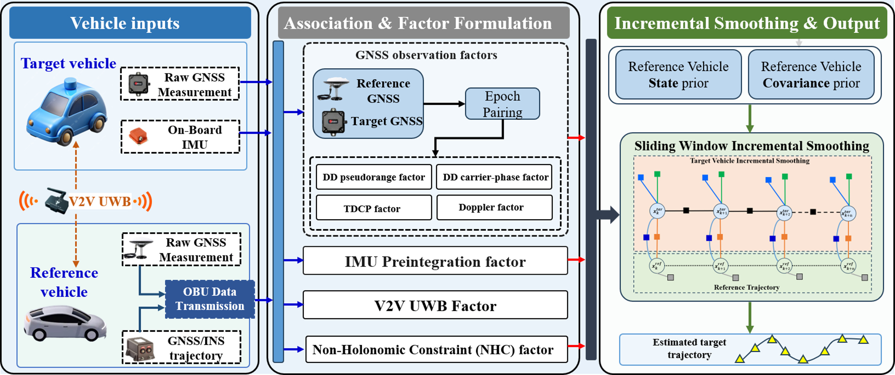
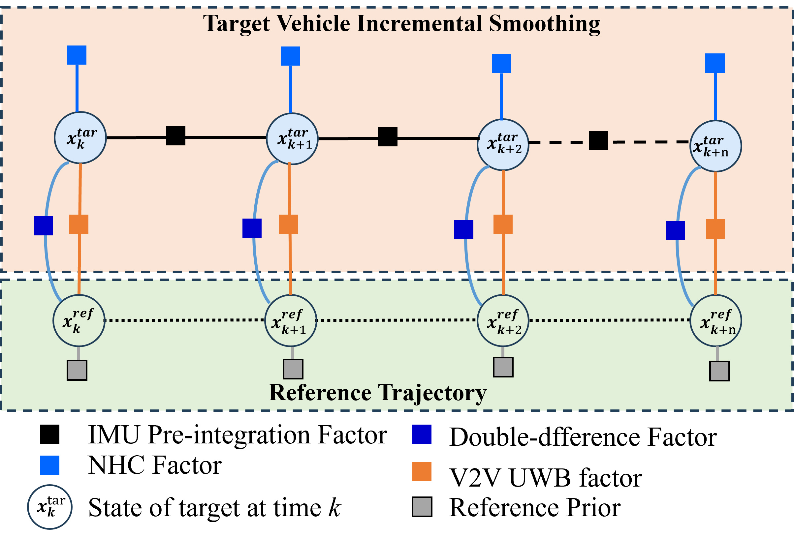

# AsymCoLoc

**Asymmetric Moving-Base Cooperative Vehicle Localization in Urban Environments via GNSS/INS/UWB Incremental Smoothing**

AsymCoLoc is a cooperative vehicle localization framework that combines Global Navigation Satellite System (GNSS) observations, inertial measurements, and inter-vehicle ultra-wideband (UWB) ranging. It studies how a vehicle with a more reliable navigation solution can assist a neighboring vehicle in urban environments, where satellite blockage, multipath, and non-line-of-sight reception can degrade GNSS positioning.

## System Overview

The system consists of a moving **reference vehicle** and a **target vehicle**. The reference vehicle shares its navigation solution and raw GNSS observations through a vehicle-to-vehicle communication link. The target vehicle contributes its onboard GNSS and inertial measurement unit (IMU) data, while UWB measures the distance between the two vehicles.

This asymmetric arrangement allows vehicles with different sensing capabilities to cooperate. Shared reference information provides global position constraints, and relative GNSS and UWB observations complement the target vehicle's inertial motion estimates.

*System overview: onboard measurements and shared reference information are combined in a sliding-window estimator to recover the target vehicle's trajectory.*

## Method Highlights

- **Moving-base GNSS cooperation:** Double-differenced GNSS observations provide relative positioning constraints between the moving vehicles.
- **GNSS/INS/UWB fusion:** A GTSAM factor graph combines cooperative GNSS observations, target IMU preintegration, inter-vehicle UWB ranges, and supporting vehicle-motion constraints.
- **Reference uncertainty:** Auxiliary reference positions are constrained by navigation priors, allowing the estimator to represent uncertainty in the supplied reference trajectory.
- **Asynchronous ranging:** The UWB factor interpolates both vehicle trajectories at the range acquisition time to account for measurements arriving at different sensor rates.

*Factor graph: inertial and navigation factors connect target states over time, while double-differenced GNSS and UWB factors couple the target trajectory to the moving reference.*

## Release Status

This repository currently provides an overview of the project and its estimation framework. The code will be open-sourced after the paper is accepted.
