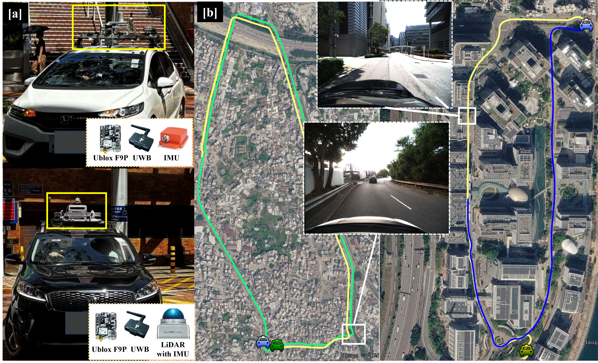
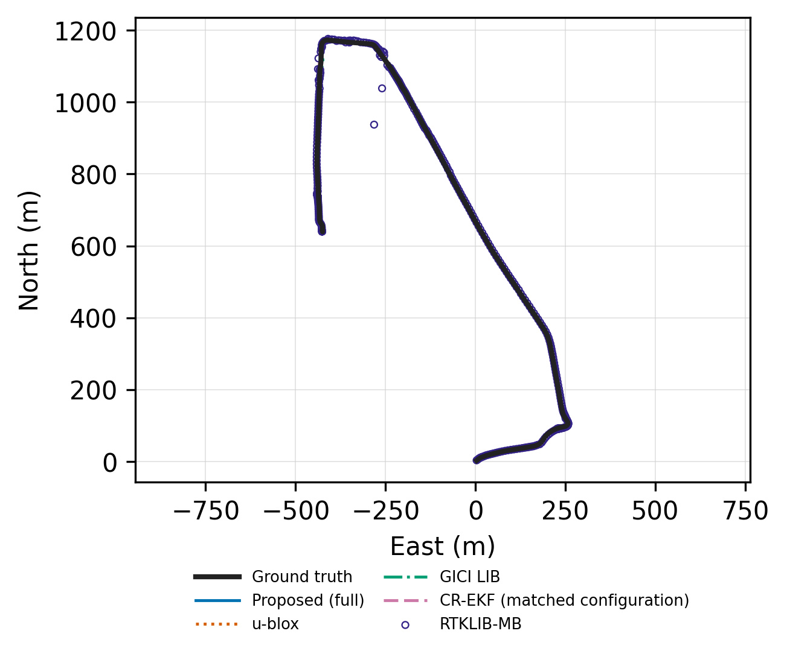
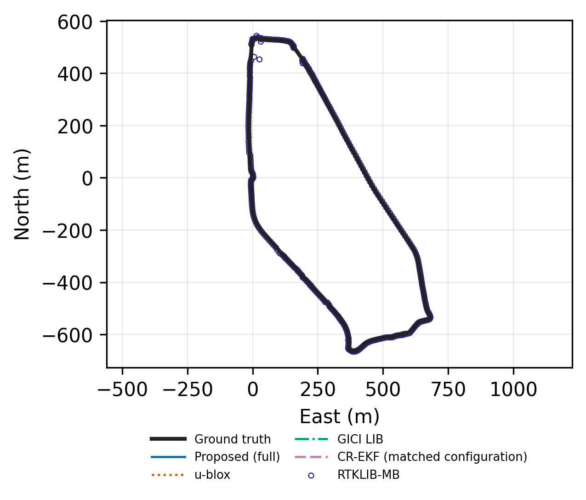
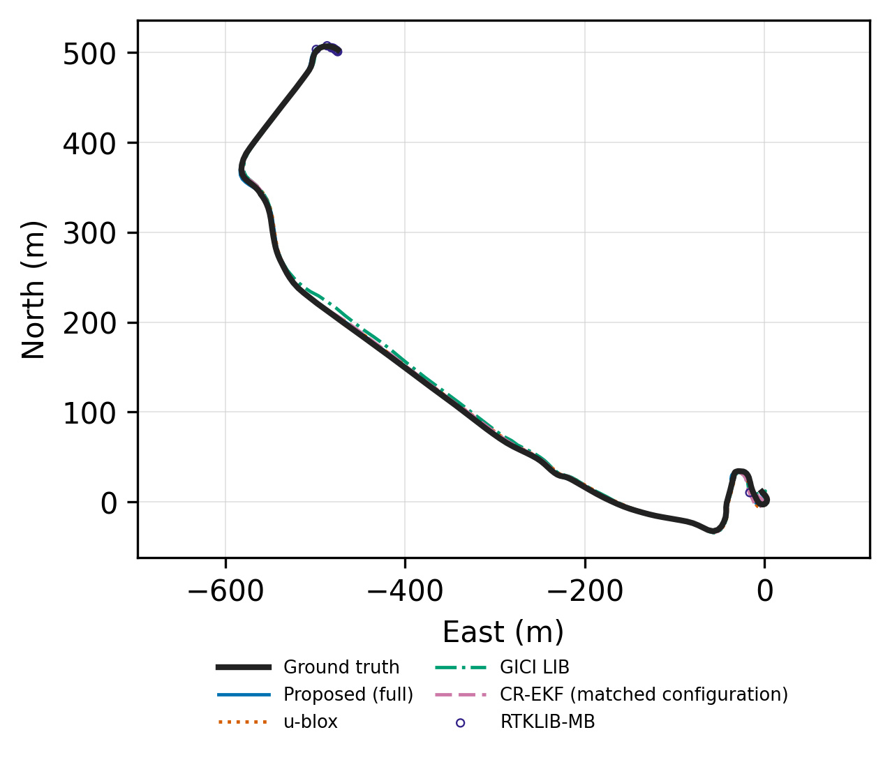
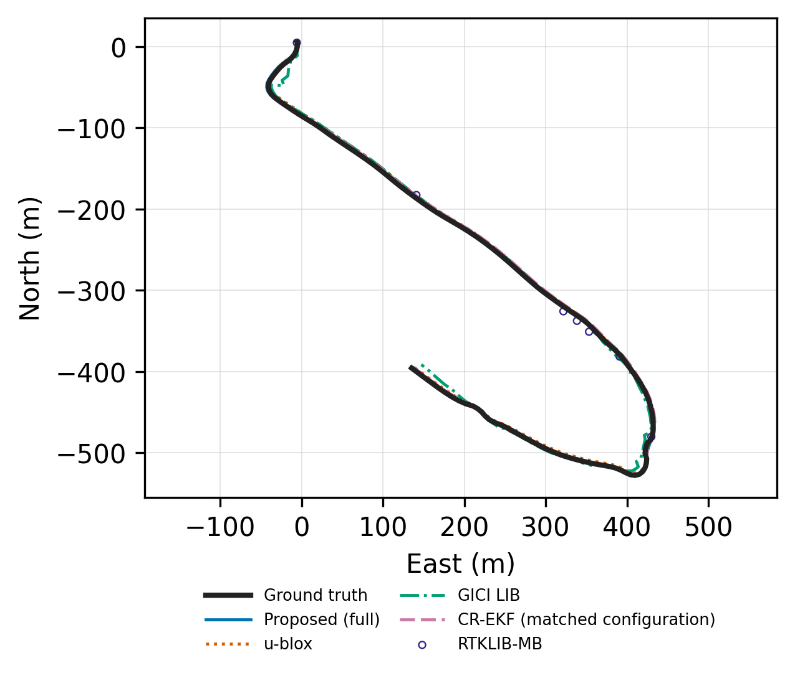

# AsymCoLoc

**Asymmetric Moving-Base Cooperative Vehicle Localization in Urban Environments via GNSS/INS/UWB Incremental Smoothing**

AsymCoLoc is a cooperative vehicle localization framework that combines Global Navigation Satellite System (GNSS) observations, inertial measurements, and inter-vehicle ultra-wideband (UWB) ranging. It studies how a vehicle with a more reliable navigation solution can assist a neighboring vehicle in urban environments, where satellite blockage, multipath, and non-line-of-sight reception can degrade GNSS positioning.

## System Overview

The system consists of a moving **reference vehicle** and a **target vehicle**. The reference vehicle shares its navigation solution and raw GNSS observations through a vehicle-to-vehicle communication link. The target vehicle contributes its onboard GNSS and inertial measurement unit (IMU) data, while UWB measures the distance between the two vehicles.

This asymmetric arrangement allows vehicles with different sensing capabilities to cooperate. Shared reference information provides global position constraints, and relative GNSS and UWB observations complement the target vehicle's inertial motion estimates.

*System overview: onboard measurements and shared reference information are combined in a sliding-window estimator to recover the target vehicle's trajectory.*

## Method Highlights

- **Moving-base GNSS cooperation:** Double-differenced GNSS observations provide relative positioning constraints between the moving vehicles.
- **GNSS/INS/UWB fusion:** A GTSAM factor graph combines cooperative GNSS observations, target IMU preintegration, inter-vehicle UWB ranges, and supporting vehicle-motion constraints.
- **Reference uncertainty:** Auxiliary reference positions are constrained by navigation priors, allowing the estimator to represent uncertainty in the supplied reference trajectory.
- **Asynchronous ranging:** The UWB factor interpolates both vehicle trajectories at the range acquisition time to account for measurements arriving at different sensor rates.

*Factor graph: inertial and navigation factors connect target states over time, while double-differenced GNSS and UWB factors couple the target trajectory to the moving reference.*

## Real-World Experiments

### Vehicle Platforms

The experiments use two instrumented vehicles: a **Honda reference vehicle** and a **Kia target vehicle**. Roof-mounted sensors record raw GNSS observations, inertial measurements, and a physical inter-vehicle UWB ranging link. The target's Livox MID-360 supplies the IMU measurements used in estimation.

| Sensor | Experimental role |
| --- | --- |
| u-blox F9P GNSS receivers | Raw GNSS observations from both vehicles at 1 Hz; target receiver PVT also provides a standalone baseline |
| Nooploop P-B UWB transceivers | Recorded inter-vehicle ranges at 50 Hz |
| Xsens MTi-30 / Livox MID-360 IMU | Reference / target inertial sensing, respectively |
| NovAtel SPAN GNSS/INS systems | Postprocessed reference navigation and target ground-truth trajectories |

*Experimental platforms and environments: Honda (upper left), Kia (lower left), and representative suburban roads and urban canyons. The reference vehicle's postprocessed navigation trajectory supplies the reference priors.*

### Driving Sequences

Four real-road sequences cover suburban roads and urban environments with buildings, turns, and roundabouts. Distances and durations below describe the archived evaluation segments.

| Sequence | Environment | Distance (km) | Duration (s) |
| --- | --- | ---: | ---: |
| Suburban 1 | Suburban road | 2.162 | 387 |
| Suburban 2 | Suburban road | 3.034 | 750 |
| Urban 1 | Urban canyon | 1.027 | 231 |
| Urban 2 | Urban canyon | 1.098 | 136 |

### Trajectory Comparisons

The following figures show archived estimates in each route's local East–North frame. They compare AsymCoLoc (labelled **Proposed (full)**), a cooperative EKF baseline (**CR-EKF**), standalone **u-blox**, and loosely coupled **GICI-Lib** against ground truth. **RTKLIB-MB** is shown only at valid output epochs using unconnected markers.

<table>
  <tr>
    <th>Suburban 1</th>
    <th>Suburban 2</th>
  </tr>
  <tr>
    <td></td>
    <td></td>
  </tr>
  <tr>
    <th>Urban 1</th>
    <th>Urban 2</th>
  </tr>
  <tr>
    <td></td>
    <td></td>
  </tr>
</table>

On the archived four-method common 1-Hz evaluation grids, AsymCoLoc achieved horizontal RMSEs of **1.278 m, 1.829 m, 1.846 m, and 1.471 m**, respectively. Relative RMSE reductions against CR-EKF were **30.03%, 4.54%, 28.46%, and 42.48%**, computed from the full-precision saved samples. On Suburban 2, CR-EKF retained lower P95 and maximum errors; the RMSE improvement does not imply an improvement in every error statistic.

These are **historical experimental snapshots**, using recorded physical GNSS/IMU/UWB measurements and a supplied postprocessed reference trajectory. Suburban 1/2 additionally use target ground truth restricted to the first second for initialization and fixed UWB-bias calibration; Urban 1/2 use raw-PVT initialization. Target ground truth is not added as a graph factor after initialization. No full-trajectory GT-derived synthetic UWB is used in these results.

See the [experiment notes and evaluation windows](results/real_world_snapshot/README.md), [complete statistics](results/real_world_snapshot/metrics.csv), and [archived trajectory samples](results/real_world_snapshot/data). Both subsequent replay audits are included because the online estimator exhibits replay variability; this snapshot is not a guarantee of identical rerun accuracy.

## Release Status

This repository currently provides a project overview, experimental-platform images, and archived trajectory results with supporting evaluation data. The estimator code will be open-sourced after the paper is accepted.
